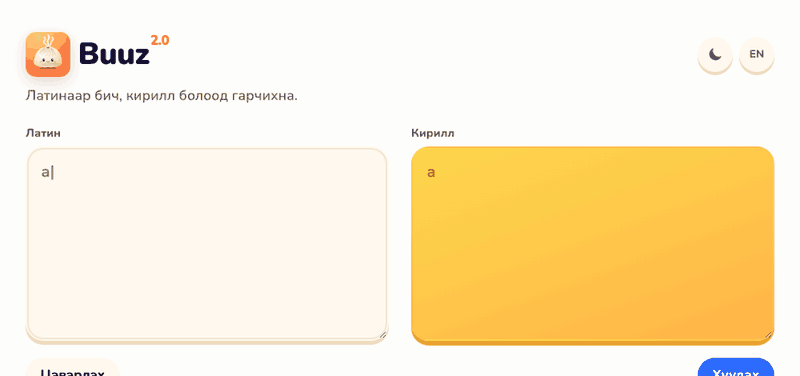
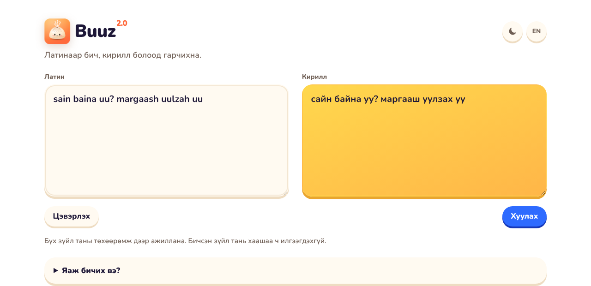

<!-- markdownlint-disable MD041 -->
<p align="center">
  <a href="https://buuz.thetengis.com">
    <picture>
      <source media="(prefers-color-scheme: dark)" srcset="docs/readme/hero-dark.png">
      
    </picture>
  </a>
</p>

<p align="center"><b>Type Mongolian Cyrillic on any Latin keyboard.</b><br>You type how it sounds. Buuz turns it into Cyrillic as you go.</p>

<p align="center">
  <a href="https://buuz.thetengis.com"></a>
  <a href="https://github.com/TengisCh/buuz/stargazers"></a>
  <a href="https://github.com/TengisCh/buuz/actions/workflows/core.yml"></a>
  <a href="#license"></a>
  <a href="https://github.com/sponsors/TengisCh"></a>
</p>

<p align="center">
  
</p>

## Try it

👉 **[buuz.thetengis.com](https://buuz.thetengis.com)**: type, copy, paste anywhere. No sign-up, nothing leaves your device.

Windows and macOS keyboards are on the way, so you can type Mongolian straight into any app. ⭐ Star the repo to hear when they land.

| Light | Dark |
| --- | --- |
|  |  |

## How to type

Most letters are what you'd guess (`b` → б, `d` → д, `sain` → сайн). The handful worth learning:

| Vowels | | Y-vowels | | Consonants | | Signs | |
| :-: | :-: | :-: | :-: | :-: | :-: | :-: | :-: |
| `e` | э | `ye` | е | `h` | х | `'` | ь |
| `w` | ү | `yo` | ё | `c` | ц | `"` | ъ |
| `q` | ө | `yu` | ю | `ch` | ч | | |
| `y` | ы | `ya` | я | `sh` | ш | | |
| `ii` | ий | | | `j` | ж | | |
| | | | | `z` | з | | |

✨ **Vowel harmony:** `o` and `u` pick о/ө and у/ү for you, so `geree` → гэрээ and `gar` → гар.

## Why Buuz

- ⚡ **Instant.** Native compiled code on every keystroke. No lag.
- 🔒 **Private.** Works offline and never stores or sends what you type.
- 🥟 **Familiar.** Same rules as the original [Buuz](https://github.com/odbayar/buuz) by Odbayar Nyamtseren, which many Mongolians have typed with since 2009. Buuz 2.0 is its community continuation.
- 💛 **Free and open source.**

## What's inside

| Path | What it is | Status |
| --- | --- | --- |
| [`core/`](core/) | `buuz-core`, the Rust engine every platform shares | ✅ Working, tested |
| [`web/`](web/) | The web converter (Rust → WebAssembly + Vite) | ✅ [Live](https://buuz.thetengis.com) |
| `windows/` | Windows keyboard (Text Services Framework) | 🛠️ Next |
| `macos/` | macOS keyboard (InputMethodKit) | 🛠️ Next |
| [`brand/`](brand/) | Mascot, icons, palette | 🎨 |
| [`docs/`](docs/) | [Architecture](docs/architecture.md) and [decisions](docs/decisions/) | 📚 |

Build and test the core:

```sh
cd core && cargo test
```

## Feedback

Found a wrong conversion, a bug, or have a fun idea? **[Open an issue](https://github.com/TengisCh/buuz/issues/new/choose)**. For a typing bug, the exact Latin you typed, what you expected and what you got is perfect. Pull requests are welcome too; see [CONTRIBUTING.md](CONTRIBUTING.md). Security issues: [SECURITY.md](SECURITY.md).

## Support Buuz

Buuz is free. Donations pay for things like the Apple developer account that lets the macOS keyboard install without warnings. If Buuz saves you time, **[sponsor it](https://github.com/sponsors/TengisCh)** 💛

## License

New code is dual-licensed under [MIT](LICENSE-MIT) or [Apache-2.0](LICENSE-APACHE), at your option. The transliteration core in [`core/`](core/) is ported from the original Buuz (Copyright 2009 Odbayar Nyamtseren) and is Apache-2.0 only. See [LICENSE](LICENSE), [NOTICE](NOTICE) and [decision 0004](docs/decisions/0004-license-mit-or-apache-for-new-code.md).

"Buuz 2.0" is an independent continuation and is not affiliated with or endorsed by the original author unless stated otherwise.
