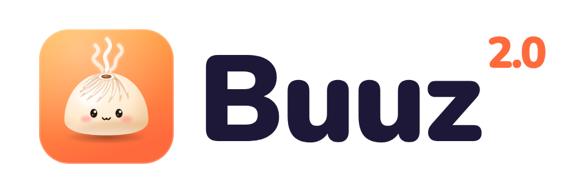

<!-- SPDX-License-Identifier: MIT OR Apache-2.0 -->
# 🥟 Buuz 2.0 brand



The mascot and app icon is **Buuz Buddy**: a pleated buuz with an open steam hole and a happy face, on an ember tile. It is used everywhere, including the favicon. The wordmark is **Buuz 2.0**.

## 📦 Ready-made files

| File | Use |
|---|---|
| [`export/buuz-buddy-1024.png`](export/buuz-buddy-1024.png), [`-512.png`](export/buuz-buddy-512.png) | 🖼️ Square logo, transparent corners (avatars, Open Collective, GitHub, stores) |
| `export/buuz-buddy-{16,32,48,64,128,256}.png` | 🔍 Small sizes; 48 px and below use the simplified glyph |
| `export/buuz-buddy-{512,1024}.jpg` | ⬜ White background, for sites that refuse transparency |
| `export/buuz-buddy-{512,1024}.webp` | ⚡ Lossless WebP |
| `export/buuz-wordmark.{png,webp,jpg}` | 🔤 Icon + "Buuz 2.0", dark text |
| `export/buuz-wordmark-light.{png,webp}` | 🌙 Same with white text, for dark backgrounds |
| [`icons/buuz-buddy-icon.svg`](icons/buuz-buddy-icon.svg) | ✏️ Vector source (128 px and up) |
| [`icons/buuz-buddy-small.svg`](icons/buuz-buddy-small.svg) | ✏️ Vector glyph for 16 to 32 px |
| [`social-preview.png`](social-preview.png) | 🔗 1280×640 link preview (GitHub, Open Graph) |

Rebuild everything (needs Python, Pillow and Playwright):

```sh
python3 brand/generate.py brand/icons && node brand/export.js && python3 brand/webp.py
```

The README hero ([`../docs/readme/hero.png`](../docs/readme/hero.png)) is a transparent, theme-neutral image: its colours keep at least 3:1 contrast on both GitHub's light (`#ffffff`) and dark (`#0d1117`) backgrounds. Rebuild it with (needs Playwright, see `tools/lint`):

```sh
NODE_PATH=tools/lint/node_modules node brand/readme-hero.js
```

[`brief.md`](brief.md) has the reasoning behind the brand.

## Palette

| Token | Hex | Use |
|---|---|---|
| Dough | `#FFF3E0` | page, cards |
| Ember | `#FF6A3D` | brand, hero output, mascot tile |
| Amber | `#FFB648` | gradient start, warm accents |
| Khadag Blue | `#2E6BFF` | the one primary action, links |
| Night | `#1E1838` | text; dark-mode background |
| Filling | `#8C4A2B` | tiny accents |
| Blush | `#FF8E8E` | cheeks, small delights |
| Steam | `#FFFFFF` | highlights, motion |

## Type

Nunito (900 headlines, 700 UI), rounded and warm, with full Mongolian Cyrillic (Ө ө Ү ү, checked in the brand sheet). JetBrains Mono for key hints. Both OFL.
