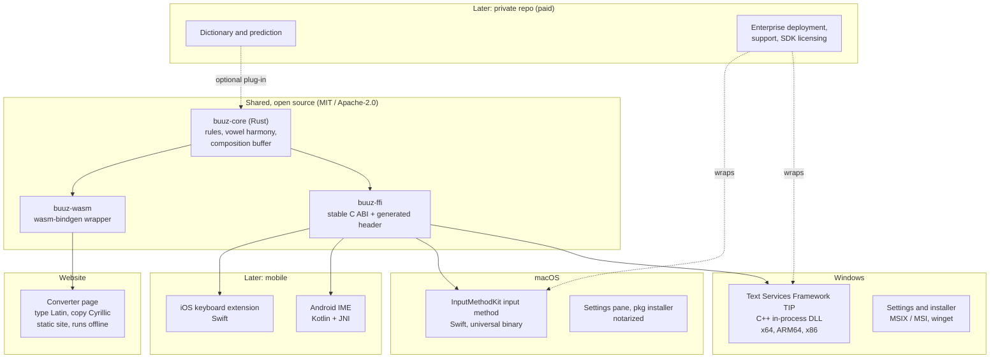
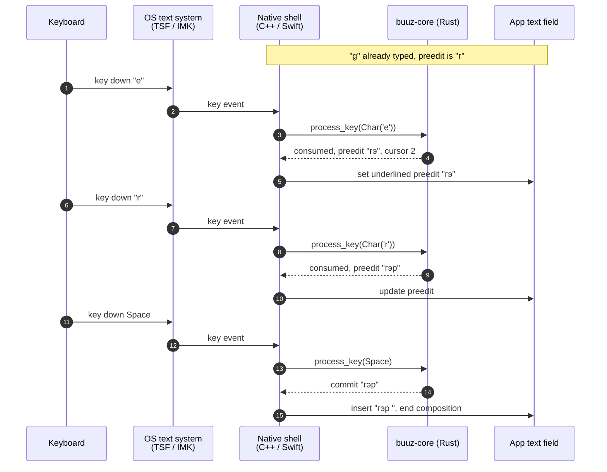
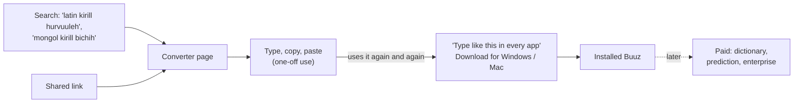
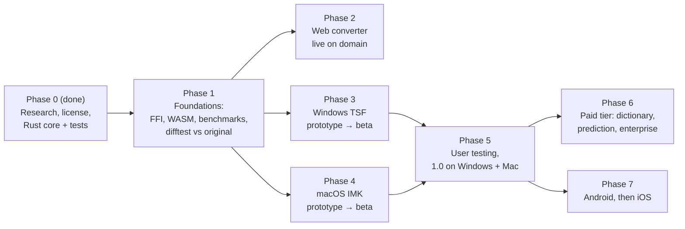

# Buuz 2.0: architecture and long-term roadmap

Status: proposed plan, November 2026. Owner: T. This document sets the
direction; each phase gets its own detailed design when it starts.

## 1. Goals, in priority order

1. **Native speed and a snappy feel.** Typing must feel identical to typing
   without an input method. This beats portability and beats development
   convenience whenever they conflict.
2. **Correct, faithful rules.** Same output as the original Buuz, including
   vowel harmony and case handling, on every platform.
3. **Private and offline.** No network, no logging of keystrokes, ever, in
   the typing path.
4. **Reach.** Windows and macOS first, a web converter as the zero-install
   entry point and funnel, mobile later.
5. **Sustainable.** Open core (free, MIT OR Apache-2.0; ported core Apache-2.0) with room for paid add-ons in
   a separate private repository.

## 2. The big decision: one shared core, or separate per platform?

**Recommendation: one shared Rust core, compiled to native machine code on
every platform (and to WebAssembly only for the website), with a thin shell
written in each platform's own language.**

### Why this is also the fastest option

The worry with a shared core is usually speed. Here it does not apply:

- Rust compiles to the same kind of native machine code as C++ or Swift.
  There is no interpreter, virtual machine, garbage collector or JavaScript
  bridge between the keystroke and the result.
- The work per keystroke is tiny: a longest-match lookup in a table of about
  200 rules over a buffer of at most 50 characters. That takes microseconds.
  A hand-written C++ or Swift version would not be measurably faster.
- The real latency risks live in the **platform shell**: how fast the input
  method is loaded, how it talks to the text field, how it draws the
  underlined preedit text. Those parts are written natively per platform
  anyway (C++ on Windows, Swift on macOS), so each platform gets the most
  idiomatic and fastest integration.

So the split is: **the shared part is the part where sharing is free; the
native part is the part where native matters.**

### Why not separate implementations

| | One Rust core + native shells (recommended) | Separate rewrite per platform |
| --- | --- | --- |
| Speed per keystroke | Native, microseconds | Native, microseconds (no gain) |
| Same output everywhere | Guaranteed, one test suite | Drifts over time; every rule fix done 3 to 5 times |
| Effort for a rule fix | Once | Once per platform |
| Paid features (dictionary, prediction) | Written once, sold on all platforms | Rewritten per platform |
| Platform feel | Native shell per platform | Native |
| Web | Same core as WebAssembly | Separate JavaScript port |
| Cost | Small FFI layer to maintain | Several codebases to keep in sync |

Typing rules are the product. Two implementations that disagree on whether
`geree` becomes `гэрээ` would be the most visible bug Buuz could have, and
separate codebases make that inevitable.

### Fallback

If WebAssembly ever proves awkward on the web (it should not: the core has no
dependencies and should compile to a few tens of kilobytes), the core already
exposes its rule table (`export_rules`), so a small JavaScript engine can be
generated from the same data and tested against the same cases. Native
platforms never need this.

## 3. System overview



### Repository layout (monorepo)

```text
buuz/
├── core/                 buuz-core: pure Rust, no I/O, no dependencies
├── ffi/                  buuz-ffi: C ABI (cbindgen header), panic-safe
├── web/
│   ├── wasm/             buuz-wasm: wasm-bindgen wrapper
│   └── site/             static converter website
├── platforms/
│   ├── windows/          TSF text service (C++), installer, settings app
│   └── macos/            InputMethodKit app (Swift), installer
├── mobile/               later: android/, ios/
├── data/
│   └── wordlist/         Mongolian word list (CC BY-SA 4.0)
├── tools/
│   ├── wordlist/         builds the word list from a Wikipedia dump
│   ├── difftest/         compares buuz-core with the original C++ Composer
│   └── bench/            per-keystroke latency benchmarks
└── docs/
```

One repository keeps the core and its consumers changing together in one pull
request. Paid components live in a separate private repository that depends on
the public `core/` and `ffi/` crates by version.

## 4. The typing path and its performance budget



| Stage | Budget | How we keep it |
| --- | --- | --- |
| `process_key` in core | under 10 µs at the 99th percentile | Static rule table, bounded buffer, no I/O; benchmark in CI fails on regression |
| Shell overhead (FFI call, string conversion, preedit update) | under 1 ms | C ABI, no serialization, UTF-16 output for Windows written into a caller buffer |
| Key to glyph on screen | within one display frame (16 ms at 60 Hz) | Nothing asynchronous on the typing path |
| Input method activation | under 50 ms | Small binaries, no work at load, lazy settings read |

Rules for everything on the typing path, on every platform:

- No network, no disk writes, no logging of typed text.
- No locks shared with other threads, no async work, no allocation that
  grows with history.
- A panic or error in the core must never crash the host app. The FFI layer
  catches panics and fails open (the key passes through untouched).

### Why composition (underlined preedit) and not direct replacement

Vowel harmony means a later key can change earlier letters (`o` becomes `ө`
after front vowels in the same word). Holding the current word as preedit
text and committing it on space or punctuation is what makes that correct
without flicker or backspacing in the app. This matches the original Buuz
and how Chinese, Japanese and Korean input methods behave, so apps handle it
well. A future "direct mode" for apps with poor composition support can be a
setting.

## 5. Platforms

### 5.1 Windows: Text Services Framework (TSF)

- **Form:** a TSF Text Input Processor, an in-process COM DLL that Windows
  loads into each app the user types in. This is the only way to get
  first-class composition in modern apps (Office, browsers, Store apps,
  Windows Terminal).
- **Language:** C++ for the COM and TSF plumbing, linking `buuz-ffi` as a
  static library. C++ is the shortest path for TSF; the Windows SDK samples
  and all reference IMEs use it. (Rust with the `windows` crate is possible
  but adds COM boilerplate and fewer references.)
- **Architectures:** x64 and ARM64 (plus ARM64X so x64 apps emulated on ARM
  PCs still load it), and x86 for 32-bit apps that are still common.
- **Correctness details to plan for:** Store/sandboxed app support
  (immersive-mode registration and package-readable install folder), secure
  password fields, per-app on/off memory, a toggle hotkey, and the original
  Buuz's language bar presence.
- **Because it runs inside every app,** the DLL must be small, load nothing
  at startup and never block. This is the strongest argument against putting
  any runtime (.NET, Electron, JavaScript) in the input method itself. A
  separate settings app can use anything.
- **Distribution:** signed installer (MSI or MSIX), winget package, later
  enterprise MSI for Intune or Group Policy (paid tier). Code signing options
  and costs are in `docs/research.md`.

### 5.2 macOS: InputMethodKit (IMK)

- **Form:** an input method bundle installed in `/Library/Input Methods`,
  running as its own small background process. macOS routes key events to it
  through `IMKServer` and an `IMKInputController`.
- **Language:** Swift, linking `buuz-ffi` as a static library built as a
  universal binary (Apple silicon and Intel).
- **Feel:** marked text (preedit) through the client's `setMarkedText`, commit
  through `insertText`. No candidate window is needed for basic typing, which
  keeps it light. Secure input fields bypass input methods automatically.
- **Distribution:** Developer ID signed and notarized pkg (Apple Developer
  Program, USD 99 per year), later the Mac App Store if Apple's rules for
  input methods allow it at that time, and MDM-ready pkg for enterprise.

### 5.3 Website converter (the funnel)

A one-page tool for one-off use: type Latin on one side, see Cyrillic live on
the other, press Copy. It also introduces people who have never installed an
input method to Buuz.

- **Engine:** `buuz-core` compiled to WebAssembly. The page converts on every
  keystroke with the same rules as the apps, so what people see on the web is
  what they get in the app.
- **Speed:** static HTML, CSS and a small WASM file, no framework needed, no
  server calls while typing. Cache it as a Progressive Web App so it opens
  instantly and works offline.
- **Hosting:** any static host (Cloudflare Pages, GitHub Pages or Vercel), free
  at this traffic level.
- **Privacy:** text never leaves the browser; say so on the page. Use
  cookie-free analytics only for page views and download clicks.
- **Features, in order:** two-pane live convert with Copy; a cheat sheet of
  the rules; one-click download that detects Windows or macOS; Mongolian and
  English UI; later an inline mode that behaves like the installed input
  method, and Cyrillic to Latin.



### 5.4 Mobile (later)

- **Android:** an `InputMethodService` in Kotlin with its own keyboard UI,
  calling `buuz-ffi` through JNI. The same composition model maps to Android's
  `setComposingText` and `commitText`.
- **iOS:** a custom keyboard extension in Swift linking the same static
  library. Keyboard extensions have tight memory limits and no network without
  "Full Access"; Buuz needs neither, which is a selling point.
- On phones the competition is the built-in Cyrillic keyboard, so the value
  is the Latin-phonetic layout plus (paid) prediction. Revisit after desktop
  1.0 and user feedback.

## 6. Core API evolution

The core already exposes a `Composer` (process key, preedit, cursor, commit,
cancel) and `convert` for whole strings. Planned additions, all keeping the
core free of I/O:

1. **`buuz-ffi` crate:** opaque `BuuzComposer*` handle, `buuz_process_key`,
   `buuz_preedit_utf16` / `_utf8` into caller buffers, `buuz_commit`, with
   a generated C header used by both C++ and Swift.
2. **Benchmarks** (`tools/bench`) with a CI threshold.
3. **Differential test** (`tools/difftest`): build the original C++ `Composer`
   and compare it with `buuz-core` on a large word list and random input, to
   prove behavioural compatibility instead of relying on hand-written cases.
4. **Settings as data:** the portable `Config` (see below) that the shell
   passes in as text, so no platform reimplements options.
5. **Extension point for paid features:** a trait for "suggestions for the
   current preedit" that the open core calls if an implementation is present.
   The paid dictionary and prediction crate implements it in the private
   repository; the free build simply has none.

### Portable config

A user keeps one settings file for all shells. The file is a small subset of
TOML (see [ADR 0005](decisions/0005-portable-config-format.md)). The core
reads it with `Config::parse` and gives the composer the `Options` from
`Config::options`. A shell does this once at load, never per key.

- `Config::parse` gives a `Parsed` value: the `Config` and a list of
  warnings for unknown options and sections. A shell can show them.
- The fields of `Config` are private. Getters read them. Setters check them.
- `Config::to_text` writes the canonical text for export.
- A file with a newer `buuz_config` version is refused with `TooNew`.
- The `[keys]` section is checked and stored. The core does not apply it yet.
- The core does no I/O. Each shell reads and writes the file itself.

### Word list

`data/wordlist/mn.txt` holds the most frequent words of Mongolian Wikipedia
(up to 50,000, about 48,000 now), one `word<TAB>count` line per word, under
1 MB of text. It feeds
suggestions and autocorrect (issues #1 and #2).

- **Built by** `tools/wordlist/build.mjs` from a Wikipedia dump. The dump is
  never committed. The build is deterministic.
- **Licence:** the file is derived from Wikipedia text, so it is CC BY-SA 4.0,
  with attribution to Mongolian Wikipedia contributors. It is a separate data
  file, so share-alike does not reach the app code. The root `LICENSE` says
  so, and [ADR 0006](decisions/0006-word-list-data-licence.md) records why.
  Shells must show the attribution (Mongolian Wikipedia contributors, CC
  BY-SA 4.0) in their licence screens and load `mn.txt` as a separate asset,
  never compile it into the binary.
- **In the core:** `WordList::parse` takes the text (the core does no I/O) and
  builds a sorted index once, about 10 ms in release. `contains`, `rank`, `count`,
  `prefix` and the allocation-free `top_two` then answer in microseconds.
- **Loaded on demand.** It is not on the typing path. Nothing parses it until
  a feature that needs it is switched on, and no shell bundles it yet. Issue
  #2 decides how each shell loads it.

## 7. Open core boundary

| Open source, this repo (MIT OR Apache-2.0; `core/` Apache-2.0) | Paid, separate private repo |
| --- | --- |
| `buuz-core`, `buuz-ffi`, `buuz-wasm` | Dictionary, spell suggestions, word prediction |
| Windows and macOS input methods, basic typing | Enterprise installers (MSI for Intune/GPO, MDM pkg), admin policies |
| Web converter | Priority support, SLAs |
| Rule tests and tools | SDK and commercial licensing for embedding the engine |

Keeping the typing engine public builds the trust an input method needs:
anyone can check that it does not send keystrokes anywhere.

## 8. Website domain

The converter lives at the home page of the domain, with download buttons on
the same page, so one domain does both jobs. Avoid "type" in the name so it is
not confused with Mongol Type (touch-typing training).

Availability checked on 2026-11-17 through Vercel's registrar lookup. Prices
are Vercel's first-year price in USD; recheck before buying.

| Domain | Available | Price (first year / renewal) | Notes |
| --- | --- | --- | --- |
| buuz.com, buuz.app, buuz.org, buuz.net, buuz.mn | No | | Taken |
| getbuuz.com, buuzapp.com | No | | Taken |
| **buuzkeyboard.com** | Yes | 12 / 12 | Clear to anyone: "the Buuz keyboard". Recommended main domain |
| buuz.dev | Yes | 10 / 13 | Short, but reads as a developer site; good later for the SDK |
| buuz.io | Yes | 15 / 46 | Short, expensive renewals |
| buuzime.com | Yes | 12 / 12 | "IME" is jargon for most users |
| buuzkey.com | Yes | 12 / 12 | Short alternative to buuzkeyboard.com |
| **kirill.mn** | Yes (verify) | not priced by Vercel | Mongolian, describes the job ("Cyrillic"). Recommended short alias pointing to the converter |
| galig.mn, galig.app | Yes (verify for .mn) | | "Галиг" (transliteration); good but less obvious |

**Recommendation:** register **buuzkeyboard.com** as the home (converter plus
downloads), and if budget allows a short local alias **kirill.mn** that
redirects to it. `.mn` availability came from a general registrar lookup and
must be confirmed with a `.mn` registrar before planning around it. Also
consider **buuz.dev** cheaply now to hold it for a future SDK site.

## 9. Roadmap



| Phase | Deliverable | Done when |
| --- | --- | --- |
| 0 | Research, license, `buuz-core` | Done: tests pass, LICENSE/NOTICE in place |
| 1 | `buuz-ffi`, `buuz-wasm`, benchmarks, differential test, CI on Windows/macOS/Linux | Core matches the original C++ on a large word list; `process_key` p99 under 10 µs |
| 2 | Converter website on the chosen domain | Live, works offline, converts on every key with no visible lag on a mid-range phone |
| 3 | Windows input method | Types correctly in Notepad, Word, Edge, Chrome, Teams, Terminal; signed installer for x64 and ARM64 |
| 4 | macOS input method | Types correctly in TextEdit, Pages, Safari, Chrome, Slack; notarized installer |
| 5 | 1.0 | 10+ outside testers on each OS, no open rule bugs, published releases |
| 6 | Paid add-ons | First paying customer or sponsor; private repo set up |
| 7 | Mobile | Decided after 1.0 based on demand |

The web converter (Phase 2) is small and can ship early, in parallel with
Windows work. It gives people something useful immediately, tests the rules
with real users, and starts the download funnel before the apps are ready.

## 10. Risks

| Risk | Impact | Mitigation |
| --- | --- | --- |
| TSF quirks in specific apps (Office, Chromium, Store apps) | Broken typing in popular apps | Test matrix per release; follow Microsoft's TSF samples closely |
| Code-signing cost or SmartScreen warnings on Windows | Users scared off at install | SignPath Foundation for open source, or Microsoft Store distribution |
| macOS input method rules change between OS versions | Breakage after updates | Test on macOS betas each summer |
| Rule drift from the original | Old Buuz users notice differences | Differential test in CI |
| Pending US "BUUZ" software trademark application | Naming conflict for a US paid product | See `docs/research.md`; distinct name for paid SDK if needed |
| Single maintainer | Slow progress | Open source, clear CONTRIBUTING, small scoped issues |

## 11. Decisions log

| Date | Decision |
| --- | --- |
| 2026-11-17 | Ship as "Buuz 2.0", a credited continuation |
| 2026-11-17 | New code MIT OR Apache-2.0; ported `core/` stays Apache-2.0 (decision 0004) |
| 2026-11-17 | Open core: free engine and basic typing public; paid features in a private repo |
| 2026-11-17 | One Rust core compiled natively per platform (WASM on web), native shells per platform (proposed in this document) |
