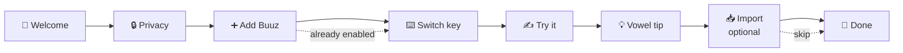

<!-- SPDX-License-Identifier: MIT OR Apache-2.0 -->
# Desktop app: onboarding, settings and menu (macOS + Windows)

Status: **design proposal, November 2026.** Nothing here is built yet; the
apps wait for T's go-ahead. Mockups: [`design/desktop-onboarding/`](../design/desktop-onboarding/)
(open `index.html`, or see `previews/`). Architecture: [`architecture.md`](architecture.md) §5.

## 1. Inspiration: what Wispr Flow gets right

Wispr Flow (voice dictation, macOS + Windows) is widely praised for a short,
polished setup. Its structure, from its help centre and reviews:

| # | Wispr Flow step | What makes it good |
|---|---|---|
| 1 | Sign in via browser | (We skip this: Buuz has no accounts.) |
| 2 | Permission cards (Microphone, Accessibility) | One card per permission, triggers the native prompt, **checks itself off** when granted, skips anything already granted. |
| 3 | Mic test with a live level meter | Proves the hardware works before you need it. |
| 4 | Hotkey setup | Sensible default (fn on Mac), "press it now" to confirm. |
| 5 | Languages, privacy / data choice | Privacy is a screen of its own, not small print. |
| 6 | "Try it yourself" in fake apps | **Teaching by doing**: you dictate into a pretend chat/email, not a video. Each demo can be skipped. |
| 7 | Before / after demo | One "aha" about the clever part (cleanup). |
| 8 | Lands on the Hub | Home shows your shortcut and history; tray/menu-bar icon for quick access. |

Patterns we take: one idea per screen, big friendly title + one line, a
single blue primary button, progress dots, live detection instead of "did
you do it?" questions, a real try-it moment, safe to quit and resume.
We take the **structure and quality bar only**: no Wispr assets, copy, colours
or layouts. Everything visual is Buuz's own brand (Buuz Buddy, dough/ember,
Khadag Blue, Nunito, emoji and icons over text).

## 2. Principles

1. **Under 60 seconds** from first launch to typing Cyrillic in any app.
2. **Zero permissions.** An input method needs no Accessibility, microphone or
   network access. We say so; it is a selling point.
3. **Detect, don't ask.** Every setup step shows a live status that flips to ✅ by itself.
4. **Teach by typing.** Real keystrokes through the real input method.
5. **Mongolian first, English one click away** (МН/EN pill in the title bar,
   same rule as the website: do not follow the OS language).
6. **Light theme by default** with a toggle in General (same as the website).
7. **Resume anywhere.** Quitting mid-setup reopens on the same step.

## 3. Onboarding flow

Window: 760 × 540, fixed, centred, not resizable. Steps 2 to 8 show progress
dots and Back / Next. Copy below is MN (default) / EN.

### 3.1 👋 Welcome (`mac-welcome.png`)
- Large Buuz Buddy (steam puffs once on open), title
  **«Латинаар бич, кирилл болоод гарна» / "Type Latin, get Cyrillic"**.
- Animated demo line: `sain baina uu` → **сайн байна уу**, typed letter by letter.
- One line: «Бүх апп дотор. Интернэтгүй. Шууд.» / "In every app. Offline. Instantly."
- Button **Эхлэх / Get started**. Credit line: continuation of Buuz by
  Нямцэрэнгийн Одбаяр, open source.

### 3.2 🔒 Privacy promise (`mac-privacy.png`)
Four cards, icon + short line each:
📴 no internet needed · 🙈 no keystrokes saved or sent · 👤 no account ·
🔐 off in password fields. GitHub pill links the source. Button **Ойлголоо / Got it**.
This replaces Wispr's sign-in and data-preference screens.

### 3.3 ➕ Add Buuz (`mac-enable.png`, `win-enable.png`, `*-enable-done.png`)
Equivalent of Wispr's permission cards. A status card «Buuz · Монгол» shows
⏳ waiting → ✅ added, updated live.

| | macOS | Windows |
|---|---|---|
| One-click **Нэмэх / Add Buuz** | `TISRegisterInputSource` + `TISEnableInputSource` on the bundle in `/Library/Input Methods` (what Squirrel and other IMs do). macOS may show its own confirmation. | `ITfInputProcessorProfileMgr::RegisterProfile` at install, then `InstallLayoutOrTip` to add Mongolian (mn-MN) with Buuz to the user's language list. |
| Detection | `kTISNotifyEnabledKeyboardInputSourcesChanged` + `TISCreateInputSourceList` | `ITfInputProcessorProfileActivationSink` / re-read enabled profiles |
| Fallback (shown under «эсвэл өөрөө»): breadcrumb + **Open Settings** deep link | System Settings › Keyboard › Input Sources › Edit › ＋ › Mongolian › Buuz (`x-apple.systempreferences:com.apple.Keyboard-Settings.extension`) | Settings › Time & language › Language & region › Монгол › Options › Add a keyboard › Buuz (`ms-settings:regionlanguage`) |

If Buuz is already enabled, the step is skipped (like Wispr skipping granted
permissions). Success: title becomes «Болчихлоо! 🎉», mascot hops.

To verify while building: whether macOS 14 / 15 / 26 still allows
`TISEnableInputSource` from a notarized app without extra prompts.

### 3.4 ⌨️ Switch key (`*-shortcut.png`)
Three cards, recommended one pre-selected with ⭐:

| macOS | Windows |
|---|---|
| ⭐ 🌐 fn (Globe), the default on newer Macs | ⭐ ⊞ Win + Space (system language switch) |
| ⌃ Control + Space (classic "previous input source") | Ctrl + Space: **Buuz on/off** inside Buuz, stays in Mongolian (TSF preserved key; good for quick Latin words) |
| ⇪ Caps Lock (macOS "use Caps Lock to switch to and from ABC") | Alt + Shift (classic) |

macOS shortcuts are system settings, so Buuz sets the matching preference where
it can, or deep-links Keyboard › Keyboard Shortcuts › Input Sources. Below the
cards: «Одоо дараад үз 👉» with a live indicator `ABC ⇄ 🥟 Монгол`; the keycaps
light up when pressed, and «✅ Ажиллаж байна!» appears after one round trip
(detected through the input-source-changed notification / TSF profile sink).

### 3.5 ✍️ Try it (`*-try.png`)
A pretend chat (generic, no real brand) with «Ээж». The text field is a real
text field, so typing goes through the **real Buuz input method** with the
underlined preedit, exactly as in other apps. Three task chips check off as
you type them:

1. сайн байна уу `sain baina uu`
2. баярлалаа `bayarlalaa`
3. өнөөдөр `qnqqdqr`: a gentle trap. Most people type `unuudur` and get
   унуудур, which leads naturally into the next tip.

If Buuz is not the active input source, a hint shows the chosen switch key.
**Алгасах / Skip** is always available.

### 3.6 💡 Vowel tip (`*-harmony.png`)
Two cards:
- 🪄 **Эгшиг өөрөө зохицно**: with э, ө, ү in the word, o → ө, u → ү.
  `nomoo` → ном**оо**, `gertoo` → гэрт**өө**, `teruu` → тэр**үү** (all checked against `buuz-core`).
- 🎯 **Заавал ө, ү хэрэгтэй бол**: `q` → ө, `w` → ү, `'` → ь, `"` → ъ; `qndqr` → **ө**нд**ө**р.

When issue #7 (smarter vowel harmony) lands, update the examples from its tests.

### 3.7 📥 Import from the web (optional, `*-import.png`)
Follows the portable config design in issue #8. Two cards:
- 🔗 **Вэбээс илгээх**: on buuz.thetengis.com, a «Апп руу» button opens
  `buuz://import?cfg=buuz1:…`; the app shows a diff and asks to apply.
- 📋 **Хуулж буулгах**: paste a `buuz1:…` string.
The primary button reads **Алгасах / Skip** until something is imported. Hidden
entirely until #8 ships.

### 3.8 🎉 Done (`*-done.png`)
Confetti + steam puff, «Бэлэн! 🎉», where to find Buuz
(macOS: **Б** in the menu bar; Windows: **МОН** in the taskbar), a recap card
(switch key, `q`=ө, `w`=ү), **Бичиж эхлэх / Start typing** (closes the window),
and a pre-ticked «Компьютер асахад бэлэн байлгах» (Login Item / Startup task for
the settings helper; the input method itself needs nothing).

## 4. Settings window ("Home")

Same window style, sidebar on the left (`*-home.png`, `*-typing.png`).
Opens from the menu, the Start menu / Launchpad, or by launching the app again.

| Section | Contents |
|---|---|
| 🏠 Нүүр / Home | Greeting, ✅ status (or a fix-it button if Buuz got disabled), switch key, a try box, cheat sheet of keys. No usage stats: we do not count keystrokes. |
| ✍️ Бичих / Typing | 🪄 smart vowels · 🔤 auto capitals · ✂️ abbreviations (#5, «удахгүй») · 🎛️ my own keys (#3, «удахгүй») · 🧠 remember per app (Latin stays in code editors) · 〰️ underline while typing |
| ⌨️ Товчлол / Shortcuts | Switch key (as in onboarding), Windows Buuz on/off key, "rerun the tutorial" |
| 📥 Тохиргоо зөөх / Import & export | Paste / open `.buuz` file / copy my config (#8) |
| 🔒 Нууцлал / Privacy | The four promises, link to source, "no network calls" statement, update check toggle (the only network use, off-path) |
| ⚙️ Ерөнхий / General | МН/EN, light/dark, open at login, show onboarding again, check for updates |
| 💬 Санал хүсэлт · ℹ️ Тухай | GitHub issues link; credits (Нямцэрэнгийн Одбаяр, license), version |

Feature flags marked «удахгүй» show as disabled rows with a pill, so people
see what is coming.

## 5. Menu bar (macOS) and tray (Windows)

Recommendation: **no extra icon.** An input method already owns an icon in
both systems, so Buuz puts its menu there (`*-menu.png`):

- **macOS:** the Input menu in the menu bar shows Buuz's single-colour **Б**
  template glyph when active. `IMKInputController.menu()` adds Buuz's items to
  that menu. One icon, native, nothing in the Dock.
- **Windows:** the taskbar language indicator shows **МОН** with Buuz's mode
  icon; right-click gives the same menu through a TSF `ITfLangBarItemButton`.

Menu items: header (🥟 Buuz 2.0, ● Идэвхтэй) · ✓ Монгол (Buuz) · Латин ·
⏸️ Энэ апп-д унтраах (per-app off) · 📖 Товчны хүснэгт · ⚙️ Тохиргоо… (⌘,) ·
🔄 Шинэчлэл шалгах · 💬 Санал хүсэлт · (Windows) Гарах.

If people ask for an always-visible icon (like Wispr's), add an optional
menu-bar extra / tray icon in General, off by default.

## 6. Tone, motion and sound

- **Voice:** warm, short, second person, like the website («Латинаар бич…»).
  One sentence per line. Emoji as icons, never as decoration in the middle of text.
- **Mascot reactions:** steam puff on welcome and on every ✅; a hop on success;
  confetti only on Done. Respect "Reduce motion" (fade instead).
- **Buttons:** the website's pressed style (solid 4 px bottom edge), Khadag Blue
  for the one primary action per screen.
- **Sound:** none during typing, ever. One soft "pop" on Done, off when the
  system mutes UI sounds.

## 7. Building it (when approved)

- **macOS:** settings/onboarding app in SwiftUI (separate from the IMK process,
  which stays tiny). Shares UserDefaults suite with the input method.
- **Windows:** settings/onboarding app in WinUI 3 (Windows App SDK) with Mica,
  separate from the TSF DLL; settings in `HKCU\Software\Buuz`, read by the DLL
  on focus change.
- Strings in one `strings.mn.json` / `strings.en.json` per platform, copied
  from this doc; Mongolian copy reviewed by T.
- Accessibility: full keyboard navigation, VoiceOver / Narrator labels on every
  icon-only element, focus ring in Khadag Blue.

## 8. Open questions for T

1. Optional always-visible menu-bar/tray icon, or Input menu only (recommended)?
2. Windows default: Win + Space (system) or Ctrl + Space (Buuz on/off)?
3. Ship the import step in v1, or hide it until #8 is done (recommended)?

## Sources

- Wispr Flow help centre: [setup guide](https://docs.wisprflow.ai/articles/3152211871-setup-guide),
  [navigating the app](https://docs.wisprflow.ai/articles/5096240724-navigating-the-wispr-flow-app-desktop-ios-and-android),
  [first dictation](https://docs.wisprflow.ai/articles/6409258247-starting-your-first-dictation)
- Third-party UX notes: [Wispr Flow UX reference](https://cdn.jsdelivr.net/npm/@agent-native/core@0.124.6/corpus/templates/clips/desktop/design-refs/wispr-ux.md)
